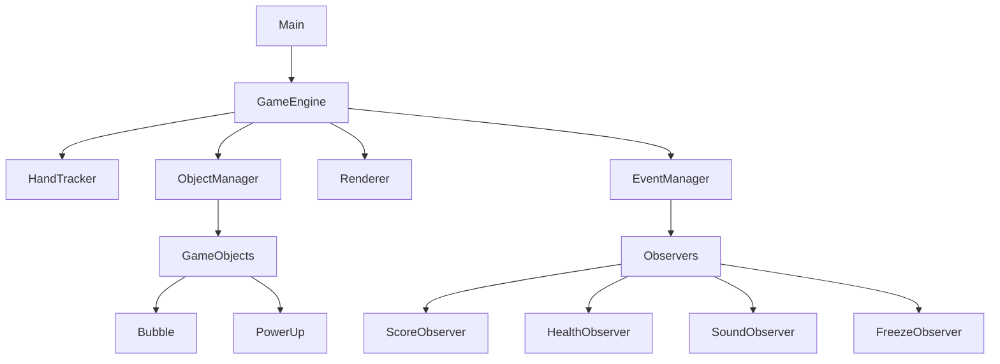
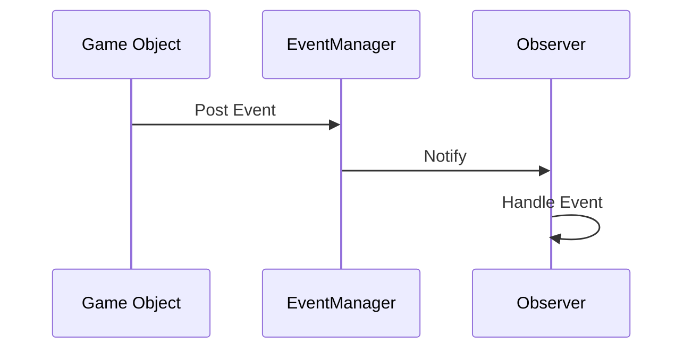

# Bubble Pop - Architecture Documentation

## Table of Contents
1. [Overview](#overview)
2. [System Architecture](#system-architecture)
3. [Core Components](#core-components)
4. [Event System](#event-system)
5. [Game Objects](#game-objects)
6. [Input Handling](#input-handling)
7. [Rendering](#rendering)
8. [Game Loop](#game-loop)
9. [Configuration](#configuration)
10. [Design Patterns](#design-patterns)
11. [Extension Points](#extension-points)

## Overview

Bubble Pop is an interactive game where players pop bubbles using fists. The game features various power-ups, score tracking, and health management. This document outlines the architecture and design decisions behind the implementation.

## System Architecture



## Core Components

### 1. GameEngine
- **Responsibility**: Orchestrates the game loop and manages overall game state
- **Key Features**:
  - Manages game state (INIT, RUNNING, GAME_OVER)
  - Coordinates between different systems
  - Handles game timing and updates
  - Manages score and health

### 2. ObjectManager
- **Responsibility**: Manages game objects (bubbles, power-ups)
- **Key Features**:
  - Object pooling for performance
  - Object spawning and cleanup
  - Collision detection
  - Object state management

### 3. EventManager
- **Responsibility**: Handles event-based communication between components
- **Key Features**:
  - Asynchronous event processing
  - Observer pattern implementation
  - Thread-safe event queue
  - Decouples components

### 4. Renderer
- **Responsibility**: Handles all rendering operations
- **Key Features**:
  - Draws game objects
  - Manages visual effects
  - Handles screen overlays (score, health, etc.)

## Event System

The game uses a robust event system for communication between components:



### Event Types
- `BUBBLE_HIT`: Triggered when a bubble is popped
- `BUBBLE_MISSED`: Triggered when a bubble reaches the bottom
- `POWER_ACTIVATED`: Triggered when a power-up is collected
- `FREEZE_END`: Triggered when freeze effect ends

### Observers
- **ScoreObserver**: Updates score when bubbles are popped
- **HealthObserver**: Decreases health when bubbles are missed
- **SoundObserver**: Plays sound effects for game events
- **FreezeObserver**: Handles freeze power-up effects
- **DestroyObserver**: Handles destroy-all power-up
- **PowerHealthObserver**: Handles health power-ups

## Game Objects

### BaseObject
- **Attributes**:
  - Position (x, y)
  - Velocity (dx, dy)
  - Radius
  - Color
  - Type
- **Methods**:
  - `update(dt)`: Updates object position
  - `draw(frame)`: Renders the object
  - `collides_with(point)`: Checks for collision

### Bubble
- **Inherits**: BaseObject
- **Additional Attributes**:
  - Points value
  - Health (for multi-hit bubbles)
  - Special effects

### PowerUp
- **Inherits**: BaseObject
- **Types**:
  - Freeze: Freezes all bubbles temporarily
  - Destroy: Destroys all bubbles on screen
  - Health: Restores player health

## Input Handling

### HandTracker
- **Responsibility**: Processes camera input to detect hand gestures
- **Features**:
  - Hand landmark detection
  - Gesture recognition
  - Touch detection

## Rendering

The rendering system is responsible for:
- Drawing game objects
- Displaying HUD elements (score, health, etc.)
- Visual effects (particles, animations)
- Screen transitions

## Game Loop

```python
def game_loop():
    while running:
        # 1. Process input
        process_input()
        
        # 2. Update game state
        update(dt)
        
        # 3. Render
        render()
        
        # 4. Handle timing
        cap_framerate()
```

## Configuration

Game parameters are centralized in `config/game_config.py`:
- Window dimensions
- Gameplay parameters (spawn rates, speeds, etc.)
- Visual settings
- Sound settings

## Design Patterns

1. **Observer Pattern**: Used in the event system
2. **Component Pattern**: Game objects are composed of components
3. **Object Pooling**: For efficient object management
4. **State Pattern**: Game states (INIT, RUNNING, GAME_OVER)
5. **Factory Pattern**: Object creation


## Performance Considerations

1. **Object Pooling**: Reuses objects to minimize garbage collection
2. **Event System**: Asynchronous processing to prevent frame drops
3. **Collision Optimization**: Spatial partitioning for efficient collision detection
4. **Rendering**: Batch rendering where possible

## Dependencies

- OpenCV: Computer vision and image processing
- NumPy: Numerical operations
- Pygame: Audio playback
- MediaPipe: Hand tracking